<picture>
  <source media="(prefers-color-scheme: dark)" srcset="assets/header-dark.svg">
  <source media="(prefers-color-scheme: light)" srcset="assets/header-light.svg">
  
</picture>

I build web experiences that make people *want* things: animated, scroll-driven sites that walk a visitor through the whole story of a product, a car or a home. I run **[Korava Group](#)**, a studio in Nairobi, and I build my own products alongside client work.

This profile is where I think out loud: what I'm building, what I know, and what I'm learning right now.

---

### `01` Now

- **Korava Group:** shaping the animated 3D campaign-site offer for automotive brands, and exploring real estate next
- **Kiasi:** behavioural money tracking for M-Pesa users

Updated by hand, monthly.

### `02` Selected work

| Project | What it is | Stack |
|---|---|---|
| **[Kiasi](https://github.com/Esther-chepunton/kiasi)** | Behavioural money tracking for M-Pesa users: upload your M-Pesa statement and it turns your transactions into insight | Next.js · Django REST |
| **[Kijiji](https://github.com/Esther-chepunton/Nairobi_nest)** | Discovery platform for Kenya: ranks places by mood, time, budget and company; day plans; guide booking via M-Pesa STK Push | React · Vite · Flask · Postgres · Daraja |
| **[MysticStudio](#)** | Fully animated one-page furniture store | Next.js · Tailwind |
| **[Mystic-OS](#)** | Korava's internal design system: palette, type, components, reference framework | Tailwind · Magic UI |

### `03` What I work with

**Frontend:** React, Next.js, Tailwind CSS · **Backend:** Django REST Framework, Supabase · **Ship:** Vercel · **Tools:** Cursor, VS Code, Context7 MCP

I care most about the micro-decisions that stop a site from feeling like every other AI-generated page.

### `04` Field notes: what I'm learning

Short, honest notes from real work. Full archive → **[field-notes](https://github.com/Esther-chepunton/field-notes)**

<!-- NOTES:START -->
- `2026-11-06` **[anon vs service_role keys, and the doubled /rest/v1 path](https://github.com/Esther-chepunton/field-notes/blob/main/supabase/anon-vs-service-role-keys.md)** · supabase
- `2026-11-06` **[Why AI-generated sites feel generic](https://github.com/Esther-chepunton/field-notes/blob/main/design/why-ai-sites-feel-generic.md)** · design
- `2026-11-06` **[Cursor: .mdc rules, AGENTS.md, and model choice](https://github.com/Esther-chepunton/field-notes/blob/main/ai-workflows/cursor-rules-and-agents-md.md)** · ai-workflows
<!-- NOTES:END -->

### `05` Work with me

I take on a small number of projects each quarter: animated campaign and product sites, and front-end builds with a strong design point of view.

**Email:** [chepuntone@gmail.com](mailto:estherchepunton@gmail.com) · **Questions & ideas:** [Discussions](https://github.com/Esther-chepunton/Esther-chepunton/discussions)

---

<!-- UPDATED:START -->Last synced: 06 Nov 2026, 10:39 EAT<!-- UPDATED:END -->
 · This README rewrites itself from my field notes via GitHub Actions.

